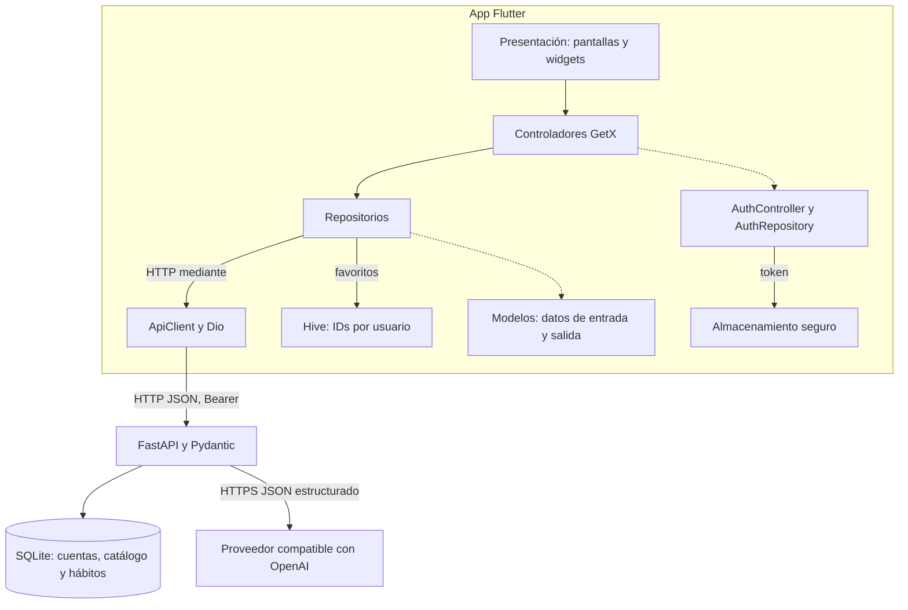

# BtoHabitos

Aplicación original de formación personal para convertir hábitos y tareas cotidianas en una rutina propia. Es independiente de ExploraEC y no está autorizada para uso institucional o productivo.

**Estado, 15 de octubre de 2026:** la app Flutter y el servidor están construidos localmente e integrados en `main` según el historial del repositorio. La validación conjunta de aceptación, el proveedor real configurado por el coordinador, CI remota, APK publicado, capturas finales y aceptación del producto siguen pendientes. La aprobación del plan no equivale a aceptar resultados. Este repositorio aún no tiene remoto.

## Qué incluye

La persona crea una cuenta, consulta un catálogo remoto de 21 plantillas, organiza sus hábitos y tareas, conserva favoritos por usuario y consulta un asistente. La app tiene tres pestañas: **Catálogo**, **Mis hábitos** y **Asistente**. El asistente propone consejos o hábitos; una propuesta requiere confirmación antes de crearla. La cuenta autenticada determina la propiedad de los registros.

## Arquitectura



La app usa Flutter/Dart, GetX, Dio, almacenamiento seguro y Hive. Hive guarda solamente IDs de plantillas favoritas por usuario; no es caché de hábitos. El servidor usa FastAPI, Pydantic y SQLite. Deriva contraseñas con scrypt y valida JWT HS256 firmado y expiración. El JWT no tiene revocación por sesión: salir borra el token local, pero uno emitido permanece válido hasta expirar o cambiar el secreto. La clave del proveedor solo existe en el entorno privado del servidor y nunca se incluye en Flutter/APK. Los errores no deben revelar secretos o datos de otras cuentas.

La decisión aprobada y sus costes/alternativas están en [ADR 001](docs/adr/001-arquitectura.md); la [especificación](docs/specs/001-habitos/spec.md) y el [contrato HTTP](docs/specs/001-habitos/contracts/README.md) detallan el comportamiento.

## Requisitos

- Flutter 3.47.6 stable y Dart 3.13.5.
- CPython 3.12 para el servidor.
- Java 17 para Android.
- El identificador Android leído de `android/app/build.gradle.kts` es `com.bto.habitos`.

## Servidor local

Desde la raíz del repositorio, crea un entorno virtual e instala las dependencias fijadas con hashes:

```sh
cd server
python3.12 -m venv .venv
.venv/bin/python -m pip install --require-hashes -r requirements.lock
.venv/bin/python -m pip check
.venv/bin/python -m pytest
cd ..
```

La copia `server/.env.example` solo documenta variables, no contiene credenciales reales. El servidor no carga `.env` automáticamente. Para preparar una configuración privada local sin sobrescribir un archivo existente:

```sh
python3.12 tool/prepare_env.py
python3.12 tool/run_server.py
```

El helper genera un `JWT_SECRET` aleatorio de 48 bytes mediante `secrets.token_urlsafe`, crea `server/.env` con permisos restringidos y deja vacíos los campos del proveedor. No imprime los valores. El cargador valida nombres, rechaza duplicados y pasa valores literalmente al proceso; no evalúa el archivo como shell. También puedes exportar variables en el entorno del proceso antes de iniciar la factory. Usa una clave propia, aleatoria y de al menos 32 bytes; no compartas ni incluyas secretos en Git.

`run_server.py` conserva el secreto en `server/.env` entre arranques y ejecuta `app.main:create_app --factory` enlazado solo a `127.0.0.1:18310`, sin access log. El arranque directo equivalente, desde `server/`, genera y exporta un secreto temporal sin imprimirlo:

```sh
export JWT_SECRET="$(.venv/bin/python -c 'import secrets; print(secrets.token_urlsafe(48))')"
.venv/bin/python -m uvicorn app.main:create_app --factory --host 127.0.0.1 --port 18310 --no-access-log
```

Para comprobar salud: `curl --fail http://127.0.0.1:18310/health`. La base predeterminada es `server/data/btohabitos.sqlite3`.

| Uso | URL | Nota |
|---|---|---|
| API local | `http://127.0.0.1:18310` | El servidor enlaza IPv4 loopback. |
| Flutter web local | `http://127.0.0.1:18311` o `http://localhost:18311` | Ambos orígenes están permitidos; `localhost` identifica el origen del navegador, no el bind del servidor. |
| Android emulado | `http://10.0.2.2:18310` | Dirección del host vista desde el emulador. |

El APK de CI usa `vars.API_BASE_URL` si está definida; de otro modo compila con `http://10.0.2.2:18310`. Un dispositivo físico necesita un endpoint HTTPS autorizado; el servidor de laboratorio se enlaza únicamente a loopback.

El proveedor debe ser una API HTTPS compatible con OpenAI, configurada solo en el servidor mediante `OPENAI_BASE_URL`, `OPENAI_API_KEY` y `OPENAI_MODEL`. La petición requiere `response_format={"type":"json_object"}`, `stream=false` y `max_tokens=512`. Para Z.ai, `OPENAI_DISABLE_THINKING=true` agrega `thinking={"type":"disabled"}`. Si falta la configuración, el endpoint no inventa respuestas y reporta servicio no disponible. No se fija aquí un modelo real.

## Flutter y CI

Desde la raíz:

```sh
flutter pub get --enforce-lockfile
flutter analyze --no-pub
flutter test --no-pub --reporter expanded
flutter run -d chrome --web-port=18311 --dart-define="API_BASE_URL=http://127.0.0.1:18310"
flutter build apk --release --no-pub --dart-define="API_BASE_URL=http://10.0.2.2:18310"
```

CI corre las pruebas del servidor, auxiliares, análisis Flutter y pruebas Flutter en runners limpios ([flujo CI](.github/workflows/ci.yml)). El [flujo de APK](.github/workflows/release-apk.yml) repite calidad y construye un APK únicamente para una etiqueta `v*`; un disparo manual sin etiqueta no construye ni publica. La publicación usa GitHub Release y un artefacto `btohabitos-apk`. La configuración Android actual firma el APK release con la clave de depuración: es un artefacto educativo, no apto para distribución productiva. No se ha ejecutado CI remota ni se ha publicado APK desde este trabajo.

## Validación y límites

La existencia de código no acredita por sí sola el recorrido completo. El coordinador debe completar análisis y suites, prueba integrada UI/API/SQLite con cuentas sintéticas, persistencia entre procesos, aislamiento A/B y casos de sesión obsoleta; la aceptación del asistente requiere proveedor real configurado de forma privada. Las suites automáticas sin credencial no acreditan IA real. Capturas reales de la versión final se añadirán después de esa validación; no se incluyen imágenes ficticias.

Referencias de ejecución: [evidencia](evidence/README.md), [plan](docs/specs/001-habitos/plan.md), [tareas](docs/specs/001-habitos/tasks.md) y [encargo de integración](docs/encargos/03-integracion-entrega.md). El lote CI/documentación/herramientas no ha sido aún aceptado por el coordinador.

## Créditos y licencias

Diseño y contenido del producto: Alberto. Proyecto original académico; no incorpora fuentes, textos ni identidad de ExploraEC. Se utilizó asistencia de IA en construcción y revisión técnica. Las licencias directas se comprobaron en metadatos oficiales; Dart pub locks y el lock del servidor siguen siendo autoridad para transitivas. La pantalla Flutter de licencias puede cubrir transitivas si se comprueba en la compilación final.

| Componente directo | Versión | Licencia | Fuente primaria |
|---|---:|---|---|
| Flutter SDK / Dart SDK | 3.47.6 / 3.13.5 | BSD-3-Clause | [Flutter](https://github.com/flutter/flutter/blob/master/LICENSE) · [Dart](https://github.com/dart-lang/sdk/blob/main/LICENSE) |
| get | 4.7.3 | MIT | [pub.dev](https://pub.dev/packages/get/versions/4.7.3) |
| dio | 5.11.1 | MIT | [pub.dev](https://pub.dev/packages/dio/versions/5.11.1) |
| flutter_secure_storage | 11.2.0 | BSD-3-Clause | [pub.dev](https://pub.dev/packages/flutter_secure_storage/versions/11.2.0) |
| hive | 2.2.3 | Apache-2.0 | [pub.dev](https://pub.dev/packages/hive/versions/2.2.3) |
| hive_flutter | 1.1.0 | Apache-2.0 | [pub.dev](https://pub.dev/packages/hive_flutter/versions/1.1.0) |
| flutter_lints | 4.0.0 | BSD-3-Clause | [pub.dev](https://pub.dev/packages/flutter_lints/versions/4.0.0) |
| fake_async | 1.3.3 | Apache-2.0 | [pub.dev](https://pub.dev/packages/fake_async/versions/1.3.3) |
| FastAPI | 0.143.2 | MIT | [PyPI](https://pypi.org/project/fastapi/0.143.2/) |
| Pydantic | 2.14.1 | MIT | [PyPI](https://pypi.org/project/pydantic/2.14.1/) |
| HTTPX | 0.28.1 | BSD-3-Clause | [PyPI](https://pypi.org/project/httpx/0.28.1/) |
| PyJWT | 2.15.1 | MIT | [PyPI](https://pypi.org/project/PyJWT/2.15.1/) |
| Uvicorn | 0.54.0 | BSD-3-Clause | [PyPI](https://pypi.org/project/uvicorn/0.54.0/) |
| email-validator | 2.3.0 | Unlicense | [PyPI](https://pypi.org/project/email-validator/2.3.0/) |
| pytest | 9.1.1 | MIT | [PyPI](https://pypi.org/project/pytest/9.1.1/) |
| Starlette | 1.8.0 | BSD-3-Clause | [PyPI](https://pypi.org/project/starlette/1.8.0/) |

El historial técnico visible con `git log -5 --oneline` registra la construcción. No hay archivo `LICENSE`: la licencia del código propio está pendiente de decisión y no se concede una por este README.
